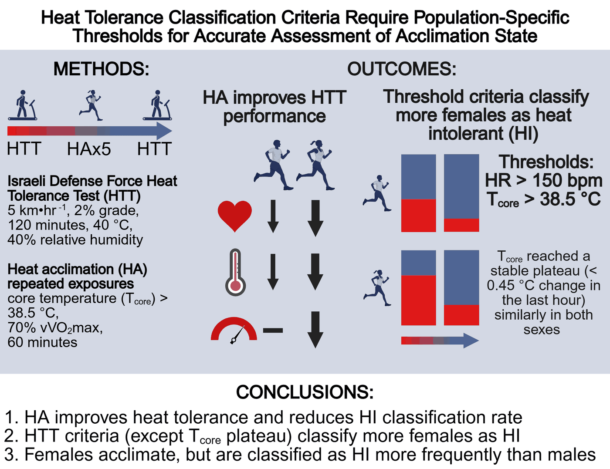
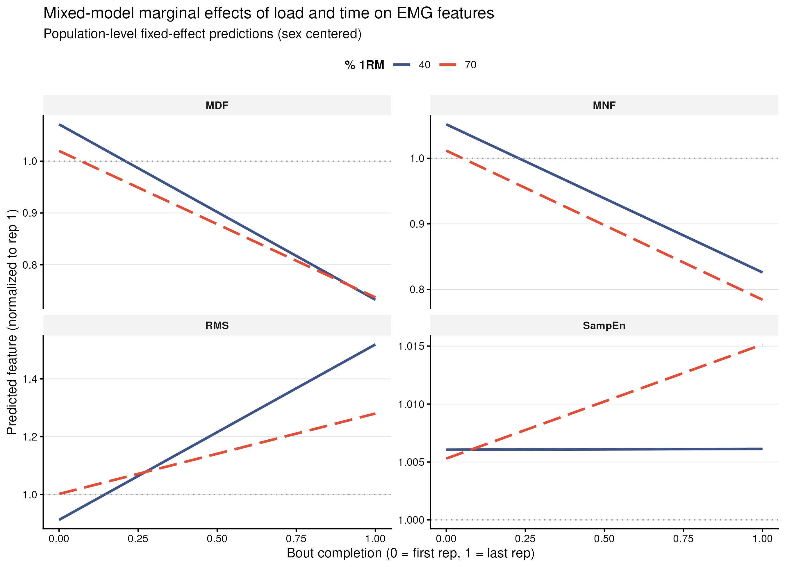
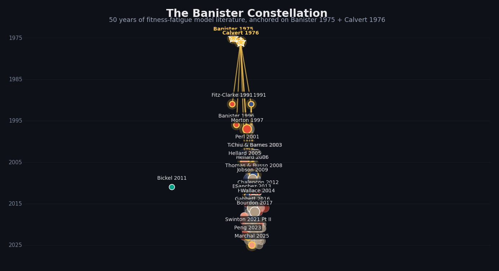
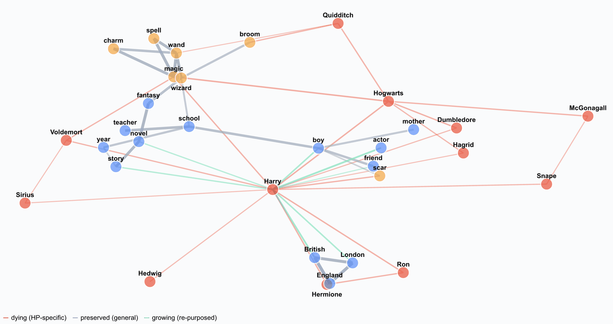
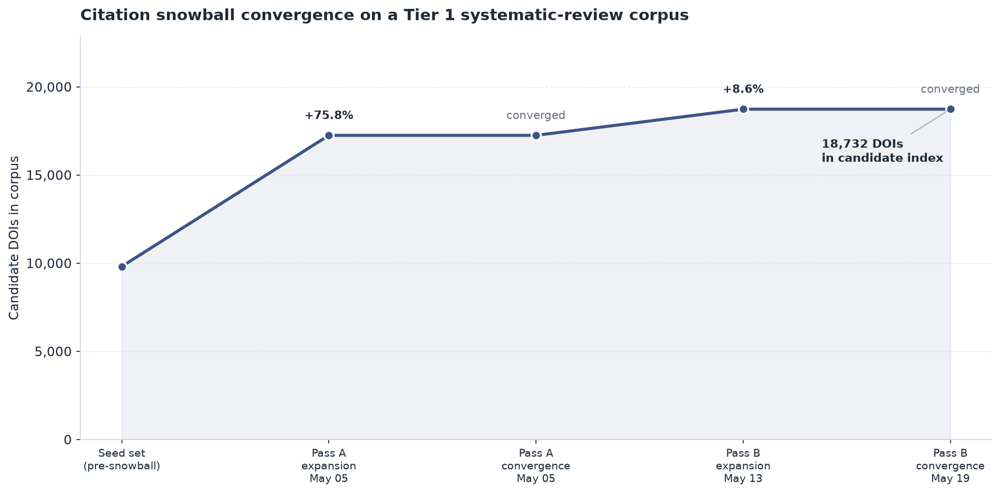

<!-- Hero. Blended voice per the 2026-05-10 decision: open with the PhD + UConn
     faculty framing, close with the ML / wearables / signal-processing pivot
     framing. Title updated 2026-09-06 for the Visiting Assistant Professor
     appointment that began 2026-08-23; aligned 2026-10-15 to the offer-letter
     wording ("Visiting Assistant Professor - Exercise Science", Dept. of
     Kinesiology). Keep cv.qmd, hire.qmd and _quarto.yml jobTitle in step.
     Bridges academic and industry audiences. Side-by-side photo + text layout
     per aesthetics audit 2026-05-11 (Schmitt/Husain pattern). -->

<h1 class="hero-name">Jacob Bowie, PhD</h1>

Visiting Assistant Professor of Exercise&nbsp;Science, Department of Kinesiology,
University of Connecticut. Research in the Human Performance Laboratory and the
Korey Stringer Institute.
Applying machine learning, wearable sensor signal processing, and reproducible
analysis pipelines to questions in exercise and environmental physiology.

Open to research partnerships, and to longer-term research and industry roles at
the intersection of applied ML, wearables, and human physiology.
<a href="mailto:jacob.bowie2@gmail.com">jacob.bowie2@gmail.com</a>

<a href="work/" class="btn btn-primary" role="button">See my work</a>

## About {.section-heading}

I study how the human body adapts to exercise and heat. My work focuses on how
to measure those adaptations rigorously, how individual responses vary, and how
to translate physiological signals from wearables and laboratory instruments
into decisions about training, recovery, and risk.

My methodological work combines mixed-effects models, unsupervised clustering,
and time-series feature extraction across heart rate, heart rate variability,
core temperature, accelerometry, and multi-omics data (transcriptomics,
proteomics, metabolomics). I work primarily in R and Python, with a strong
preference for reproducible, version-controlled, container-portable analysis.

<ul class="skill-chips">
  <li>R (tidyverse, lme4, brms)</li>
  <li>Python (pandas, scikit-learn)</li>
  <li>Mixed-effects models</li>
  <li>Unsupervised clustering</li>
  <li>Time-series signal processing</li>
  <li>Wearable sensor data</li>
  <li>Multi-omics analysis</li>
  <li>Bayesian methods</li>
  <li>Quarto / R Markdown</li>
  <li>Git &amp; reproducible pipelines</li>
  <li>Docker</li>
  <li>Clinical study design &amp; IRB</li>
</ul>

## Selected work {.section-heading}

<!-- Project 1: published heat-tolerance paper. Public-safe, links to DOI only;
     do NOT link the private Physiological_Data repo. -->

  <h3><a class="stretched-link" href="https://doi.org/10.14814/phy2.70745">Heat tolerance classification criteria require population-specific thresholds</a></h3>
  
Bowie et al., 2026 &middot; <em>Physiological Reports</em> &middot; published

  

  Re-examined the standard heat tolerance test classification criteria in a young
  adult cohort and showed that a single fixed threshold misclassifies acclimation
  state. Population-specific thresholds, built from clustering of thermoregulatory
  response curves, yield substantially better agreement with downstream
  physiological markers of acclimation.
  

<a href="https://doi.org/10.14814/phy2.70745">DOI: 10.14814/phy2.70745</a>

<!-- Project 2: leg-extension EMG fatigue salvage paper, in prep. No destination
     yet (no page, repo unreleased), so the card is deliberately NOT a link and
     carries .project-static to drop the hover lift that implies one. -->

  <h3>Surface EMG amplitude rises faster at low than high load during knee extension to failure</h3>
  
Reanalysis of an unpublished 2017 honors thesis &middot; manuscript in preparation

  

  Within-bout root-mean-square EMG amplitude rose more steeply during unilateral
  leg extension to failure at 40% than at 70% of one-repetition maximum
  (Holm-adjusted <em>p</em> &lt; 0.001 for the load &times; time interaction).
  Spectral indices and sample entropy did not separate the two loads. The
  pipeline is built end-to-end in R + Quarto inside a pinned Docker image for
  reproducibility. Manuscript in preparation for the
  <em>International Journal of Exercise Science</em>.
  

Repository will be released alongside the manuscript.

<!-- Project 3: rtSD Explorer (formerly synthesim). Browser-side marimo WASM
     explorer hosted natively at /rtsd/; R Shiny + Docker in the repo. -->

  <h3><a class="stretched-link" href="/rtsd/">rtSD Explorer: an interactive fitness-fatigue model explorer</a></h3>
  
Public release &middot; browser-side marimo + R Shiny + Docker

  

  A deterministic forward-simulator for the MEDv4 fitness-fatigue-signal ODE,
  the three-stock system-dynamics model that sits behind a long lineage of
  resistance-training adaptation research from Banister 1975 through to modern
  Bayesian extensions. Ships with a seven-test physiological-plausibility
  validator anchored to canonical RT literature. The explorer runs entirely in
  your browser via marimo + Pyodide, with an R Shiny app and reproducible Docker
  image in the same repo.
  

<a href="/rtsd/notebook/">Live demo</a>
<a href="https://github.com/JacobBowie/rtsd">Repository</a>

<!-- Project 4: citation-network visualization. The literature-graph companion
     to rtSD above. Card links to the /citation-network/ case study; the
     interactive and source repo are live (v0.1.0, 2026-05-13). -->

  <h3><a class="stretched-link" href="/citation-network/">The Banister Constellation: a citation graph of the fitness-fatigue model lineage</a></h3>
  
Research tooling &middot; Python + DuckDB + vis-network

  

  Fifty years of fitness-fatigue model literature in one constellation. A 175&#8209;paper,
  524-edge citation graph anchored on Banister 1975 and Calvert 1976, traced through
  the classical extensions of the 1980s and 1990s, the variable-dose and statistical
  critiques of the 2000s, and the modern Bayesian hierarchical reformulations. Built
  from a DuckDB literature index and explorable in the browser: pan, zoom, and
  isolate the 14-paper Banister lineage.
  

<a href="/citation-network/interactive/">Live viewer</a>
<a href="https://github.com/JacobBowie/citation-network">Repository</a>

<!-- Project: marimo-unlearning. Browser-side marimo WASM interactive explaining
     the 2023 "Who's Harry Potter?" approximate-unlearning paper. Placed among the
     interactive pieces; not part of the fitness-fatigue lineage above. -->

  <h3><a class="stretched-link" href="/unlearning/">Who's Harry Potter? An interactive walk through approximate unlearning in LLMs</a></h3>
  
Portfolio piece &middot; browser-side marimo + Pyodide

  

  Llama-2-7B took 184,000 GPU-hours to train. In 2023, Eldan and Russinovich at
  Microsoft Research showed that one GPU-hour of fine-tuning can make it forget
  Harry Potter, with no retraining from scratch and no measurable loss of general
  competence. This interactive notebook walks through the mechanism: not deleting
  the word "Harry" but cutting the edges between "Harry" and "Hogwarts", "magic",
  "Quidditch". Drag a slider and watch the Harry Potter cluster pull itself apart
  while the surrounding language graph stays intact. Runs entirely in your browser
  via marimo + Pyodide.
  

<a href="/unlearning/notebook/">Live demo</a>
<a href="https://github.com/JacobBowie/marimo-unlearning">Repository</a>

<!-- Project 5: literature pipeline tool. -->

  <h3><a class="stretched-link" href="/work/literature-pipeline.html">Literature acquisition and citation-graph toolkit</a></h3>
  
Open-source &middot; Python + DuckDB

  

  An open-source biomedical paper acquisition and citation-graph snowballing
  toolkit I built and use across a portfolio of research projects. Cascades
  Unpaywall to PubMed Central to preprint mirrors, indexes everything in
  DuckDB, walks forward and reverse citation graphs, and includes a small
  MathML-to-LaTeX rendering layer for JATS XML sidecars (76% pass rate
  through pdflatex on retrieved full-text articles).
  

<a href="https://github.com/JacobBowie/literature-pipeline">Repository</a>

## Selected publications {.section-heading}

<!-- Source-of-truth: ORCID public works feed at
     https://pub.orcid.org/v3.0/0000-0002-6055-8220/works
     Verified 2026-05-10. Static list per the Option A brief: keeps the
     Netlify build pure-static (no R/Python on CI). Refresh manually when a
     new work is registered against the ORCID. Preprints / under-review
     work intentionally excluded per the OPSEC + curation rules. -->

<ol class="pub-list">
  <li>
    <strong>Bowie&nbsp;JS</strong>, Szymanski&nbsp;MR, Struder&nbsp;JF, Filep&nbsp;EM,
    Morrissey-Basler&nbsp;MC, Brewer&nbsp;GJ, Thornton&nbsp;SN, Mahoney&nbsp;KJ, Sekiguchi&nbsp;Y,
    Kwon&nbsp;OS, Chon&nbsp;K, Casa&nbsp;DJ, Lee&nbsp;EC.
    Heat tolerance classification criteria require population-specific
    thresholds for accurate assessment of acclimation state in adults.
    Physiological Reports,
    2026.
    <a href="https://doi.org/10.14814/phy2.70745">doi:10.14814/phy2.70745</a>
  </li>
  <li>
    <strong>Bowie&nbsp;JS</strong>, Sterczala&nbsp;AJ, Kraemer&nbsp;WJ, Maresh&nbsp;CM, Comstock&nbsp;BA,
    Muñoz&nbsp;CX, McKenzie&nbsp;AL, Volek&nbsp;JS, Lee&nbsp;EC.
    Acute heavy resistance exercise protocol increases extracellular heat shock
    protein without changes in associated cytokines.
    Journal of Strength and Conditioning Research,
    2026; 40(5): 528&ndash;535.
    <a href="https://doi.org/10.1519/JSC.0000000000005373">doi:10.1519/JSC.0000000000005373</a>
  </li>
  <li>
    Mahoney&nbsp;KJ, <strong>Bowie&nbsp;JS</strong>, Ford&nbsp;AE, Perera&nbsp;N, Sekiguchi&nbsp;Y,
    Fothergill&nbsp;DM, Lee&nbsp;EC.
    Plasma proteomics-based discovery of mechanistic biomarkers of hyperbaric
    stress and pulmonary oxygen toxicity.
    Metabolites,
    2023; 13(9): 970.
    <a href="https://doi.org/10.3390/metabo13090970">doi:10.3390/metabo13090970</a>
  </li>
  <li>
    Lee&nbsp;EC, <strong>Bowie&nbsp;JS</strong>, Fiol&nbsp;AP, Huggins&nbsp;RA.
    Molecular aspects of thermal tolerance and exertional heat illness
    susceptibility. In: Adams WM, Jardine JF, eds.
    Exertional Heat Illness: A Clinical and Evidence-Based Guide.
    Springer International Publishing,
    2020: 149&ndash;168.
    <a href="https://doi.org/10.1007/978-3-030-27805-2_8">doi:10.1007/978-3-030-27805-2_8</a>
  </li>
</ol>

Full publication list, including works in preparation and conference
abstracts, is in my <a href="cv.html">CV</a> and
<a href="https://orcid.org/0000-0002-6055-8220">on ORCID</a>.

## Contact {.section-heading}

The best way to reach me is by email:
<a href="mailto:jacob.bowie2@gmail.com">jacob.bowie2@gmail.com</a>.

I read messages most days and reply within a few business days. For
collaboration inquiries please include a one-paragraph summary of the
question and any data or design constraints I should know about up front.

<!-- Site footer moved to _includes/footer.html (include-after-body in
     _quarto.yml) on 2026-10-15 so every page carries it, not just this one. -->
