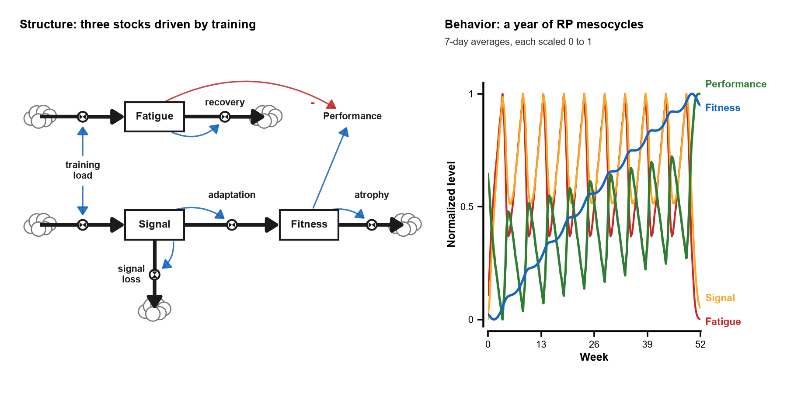
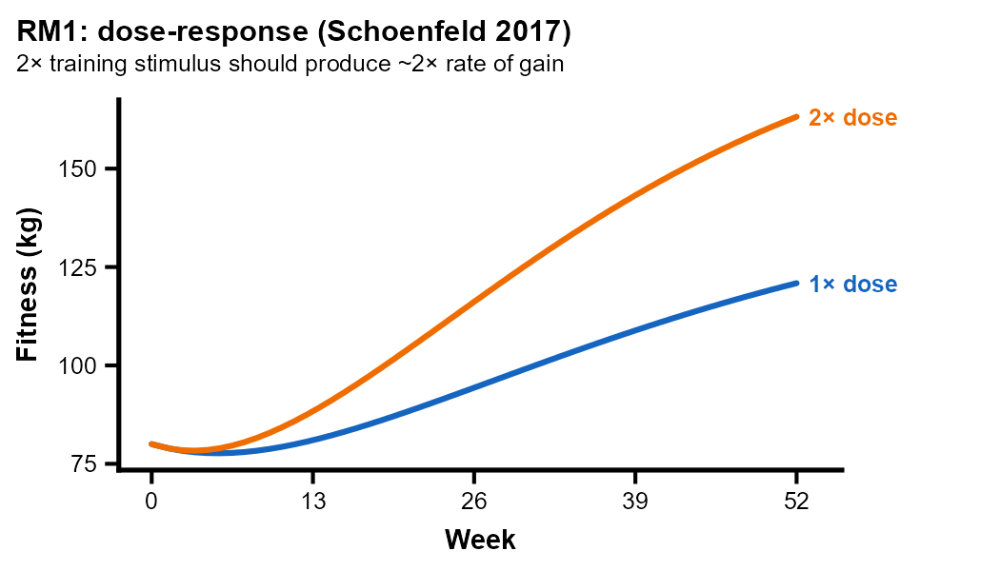

<!-- On phones (<= 576 px) the two-panel hero shrinks to ~340 px and its labels
     become unreadable (QA 2026-10-15), so narrow screens get the single-panel
     trajectory tile instead; desktop keeps the structure + behavior pair. -->
<figure class="figure">
<picture>
<source media="(max-width: 576px)" srcset="../img/rtsd-tile.png">

</picture>
<figcaption>The model and what it does: training load drives Fatigue and Signal, Signal adapts into Fitness, and Performance is Fitness net of Fatigue; simulated over a year of RP mesocycles (7-day averages, each scaled 0 to 1).</figcaption>
</figure>

## Try it

rtSD Explorer is an interactive model of how resistance training builds and erodes fitness. Pick a training program, drag the parameters, and watch four quantities (Fitness, Fatigue, Signal, and net Performance) evolve week by week. Save a run and overlay later ones to compare regimes side by side.

[**Open the interactive explorer &rarr;**](/rtsd/notebook/){.btn .btn-primary role="button"}

::: {.callout-note}
Runs entirely in your browser via [marimo](https://marimo.io) + Pyodide. No install, no server, no Python on your machine.

Inside, you can:

- Choose among **five training programs** (standard weekly, high-frequency, detraining, untrained baseline, and Renaissance-Periodization mesocycles).
- Tune the **model parameters** (training volume, adaptation rate and delay, atrophy, recovery time constants, baseline) and watch every panel recompute live.
- **Save a run** to freeze a configuration, then change the parameters and overlay the new trajectory against it.
- Read the result three ways: **live trajectory charts** (Fitness, Fatigue, Signal, Performance), the **MEDv4 stock-and-flow diagram**, and a **summary table**.

First load takes roughly 30 to 60 seconds while Python downloads into the browser. After that it is local and fast. Best on a laptop or desktop: on a phone the charts are cramped.
:::

## What you're looking at

In 1975, Eric Banister modeled training as two stocks, Fitness and Fatigue: every session is a pulse of stimulus, every adaptation an exponential decay, and predicted performance the difference between the two. That lineage, through Calvert, Busso, Morton, and the modern Bayesian reformulations, has scaffolded half a century of training-adaptation research, yet most of it lives in figures rather than in code you can run.

rtSD Explorer makes the dynamics tangible. How does a doubled training dose change the long-run fitness trajectory? Where do extra sessions stop paying off? How fast does detraining erase a year of work? The explorer answers questions like these by simulation, in the browser, with no model-fitting required.

Underneath, **rtSD** is a system-dynamics implementation of the **MEDv4** three-stock fitness-fatigue-signal ODE, originally built in Vensim and ported to a parity-tested R + Python core. It sits inside a three-tier framework:

<!-- Was a 3-column table; at 390 px it collapsed to one word per line and split
     "GET- / PAID" (audit 2026-10-15). A list reads at every width; U+2011 keeps
     GET‑PAID whole. -->

- **Framework: GET&#8209;PAID.** *Generating Expected Timelines of Predicted Adaptations to Imposed Demands*. The theoretical claim that imposed training demands produce predictable adaptation trajectories.
- **Model: rtSD.** The system-dynamics implementation of GET&#8209;PAID for resistance training: a three-stock (Fitness / Fatigue / Signal) model on the MEDv4 ODE.
- **Tool: rtSD Explorer.** This page. The browser-based marimo explorer above, backed by the same model that powers the repo's R Shiny app and Docker image.

## The seven-test plausibility validator

The methodological heart of the project is not the simulator. It is the validator that gates it.

A fitness-fatigue model has to satisfy a set of qualitative physiological constraints before it deserves to be fit to data. These are not noise-bound empirical claims; they are structural commitments. The seven reference-mode tests encode them, and the model has to reproduce each one within tolerance before any change ships:

1. **RM1: dose response.** Doubling training dose roughly doubles the long-run rate of fitness gain.
2. **RM2: detraining.** Removing all training produces a slow exponential decay back to the activities-of-daily-living floor.
3. **RM3: saturation.** Holding load constant produces a long-run plateau, not unbounded growth.
4. **RM4: fatigue dominance.** A sudden spike in load produces a transient net-performance dip before any fitness gain materializes.
5. **RM5: ADL floor.** Fitness does not fall below the activities-of-daily-living baseline regardless of how long detraining runs.
6. **RM6: taper.** Reducing load just before a target date produces a net-performance peak above the loaded-state value.
7. **RM7: overreach.** Sustained high load past a structural threshold pushes fatigue past fitness; net performance goes negative.

{fig-alt="Two fitness trajectories over 52 weeks: the 2x-dose curve rises to about 160 kg while the 1x-dose curve reaches about 120 kg, roughly twice the rate of gain." width=100%}

Each test is a one-page reference mode with a target trajectory the model must reproduce. This validator is the structural gate before anything more ambitious (Bayesian fitting against a real cohort, hierarchical extensions, individualized priors) gets built on top.

## How it is built

There is one model, exposed three ways. The authority is a small R package wrapping the ODE solve and the seven validators. A Python port (`python/rtsd/model.py`) reproduces it to within roughly 1e-15 relative deviation, gated by a parity test suite, which is what makes the browser-side surface safe to ship. The page above is that Python model compiled to WebAssembly; the same core also drives an R Shiny app and the headless validator, so a change to the model propagates to every surface at once.

```
R/med_ode.R + R/simulate.R        ── MEDv4 ODE + deSolve integrator (authority)
       │
       ├─ R/reference_mode_tests.R ─── seven-test physiological-plausibility gate
       ├─ inst/shiny/rtsd/         ─── R Shiny app
       └─ python/rtsd/model.py     ─── parity-gated Python port
                  │
                  └─ python/rtsd/rtsd.py (marimo) ─── WASM bundle ── this explorer
```

The repository ships a `CITATION.cff` so researchers can cite the specific version they explored, pinned dependency manifests for R and Python, the parity test suite, and a `Dockerfile` so `docker compose up` brings the full stack online locally.

## Where this fits

rtSD Explorer is the public, deterministic face of a larger, currently private Bayesian fitness-fatigue project (working name `getpaid`) that fits the same MEDv4 model hierarchically against an open resistance-training cohort. The public artifact and the private codebase share the deterministic core; the private codebase adds Stan, priors derived from a 175-paper citation review, and per-subject partial pooling.

The paired companion is [**The Banister Constellation**](/citation-network/), a 175-paper citation graph of fifty years of fitness-fatigue model literature that anchors the priors and frames the lineage. The two form a model-view and literature-view pair of the same intellectual lineage.

## Source and citation

- Repository: [github.com/JacobBowie/rtsd](https://github.com/JacobBowie/rtsd)
- License: MIT
- Citation: see `CITATION.cff` in the repository for the canonical form

If rtSD is useful in your own work, please reach out at **[jacob.bowie2@gmail.com](mailto:jacob.bowie2@gmail.com)**. I am especially interested in hearing from coaches and applied scientists who have qualitative reference modes the validator does not yet capture.
